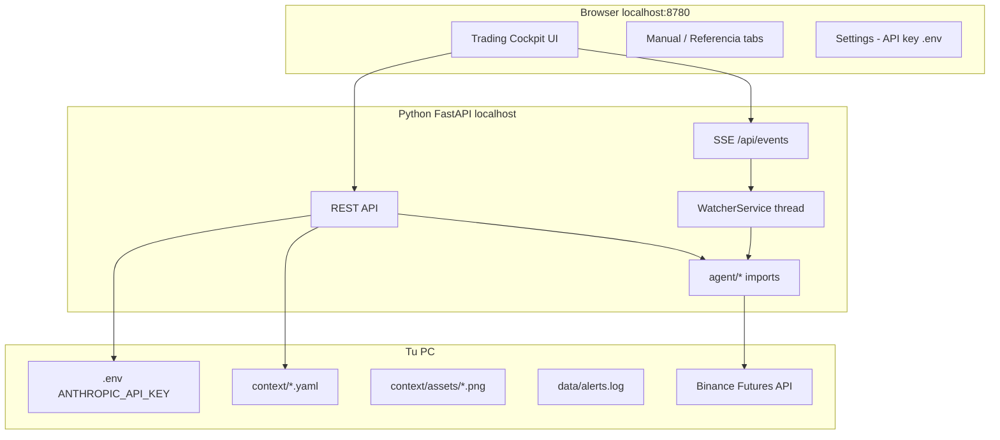

# Hype análisis y watcher
_Exported on 7/3/2026 at 17:39:14 GMT-3 from Cursor (3.5.33)_

---

**User**

analiza hype en 15min
mira las dos imagenes en 1h timeframe
estamos tendencia alcista, analiza y pon el watcher

---

**Cursor**

Pasame tu conteo Elliott HTF de BTC y HYPE cuando lo tengas; mientras tanto uso el contexto guardado y corro order flow en vivo para el análisis 15m y el watcher.


Hay una discrepancia entre ticker (~70.33) y klines en TFs bajos (~60); voy a refrescar el cache y volver a correr el análisis.


Actualizando el contexto con niveles actuales y arrancando el watcher.


## HYPE — Análisis 15m + 1H (live)

**Precio live: 70.35** | BTC 62,238 bullish (viento a favor) | OI +41k/1h (posiciones nuevas entrando)

> El `context/HYPEUSDT.yaml` estaba viejo (POI 61.70). Lo actualicé con la estructura actual y el watcher ya está corriendo.

---

### Lectura 1H (tus imágenes + data live)

| Nivel | Rol |
|-------|-----|
| **70.80** | Swing high / resistencia inmediata |
| **70.35** | Precio actual — consolidación en highs |
| **67.50** | pdHigh — ahora **soporte estructural** (flip) |
| **66.50** | dLow / pwHigh cluster |
| **64.45** | Soporte clave (línea azul en tu chart) |

**Impulso claro:** vela 14:00 con +172k delta y 1M vol rompió todo. Desde ahí consolidación 69.5–70.8 con toma de ganancias (15–16h delta negativo) pero **precio aguantó** — típico de tendencia fuerte.

Tu footprint (2da imagen) confirma: delta pasó de rojo a verde en el impulso. Ahora estás en la **parte alta del rango**, no en POI de entrada.

---

### 15m — estado actual

```
TICKER: 70.35
Trend: neutral (consolidación)
RSI: 57 | vol 0.30x (bajo — sin pelea)
Swing: hi 70.80 / lo 69.49
Delta 10v: +38k (neto positivo en el rango)
Live buy_ratio: 0.52 → micro presión vendedora momentánea
Book: bullish (3.2x bids)
```

**Últimas velas 15m:** ping-pong 70.27–70.74, sin volumen ni delta flip limpio. Patrón `cvd_bearish_divergence` en el watcher = precio en highs pero flujo live flojo.

---

### Veredicto: NO entrar ahora

Estás **~$0.70 arriba del POI long** y **dentro de la zona short** (70.65–70.95). Perseguir long acá viola la regla de no entrar tarde.

| Setup | Zona | Condición | Estado |
|-------|------|-----------|--------|
| **LONG continuation** | 69.35–69.65 | sweep + delta flip + vol > MA | ⏳ Esperar pullback |
| **LONG profundo** | 67.30–67.70 | retest pdHigh con absorción | ⏳ Más abajo |
| **SHORT rechazo** | 70.65–70.95 | drenaje delta + buy_ratio < 0.48 | 👀 Cerca — vigilar |

Para **ENTRADA MECÁNICA long** necesitás las 4 señales en el POI (línea → mecha → vol → delta verde). Acá falta: **precio en POI** y **volumen**.

---

### Watcher activo

```
python scripts/hype_watch.py HYPEUSDT --scalp --bias both --timeframe 15m --interval 30
```

- **LONG** alerta en 69.35–69.65 (SL 69.10 → TP 70.50 / 70.80 / 71.20)
- **SHORT** alerta en 70.65–70.95 (SL 71.10 → TP 69.80 / 69.35)
- Sonido + toast Windows + log en `data/alerts.log`
- Escanea 1m / 5m / 15m cada 30s

Primer scan: **B NEAR SHORT 70%** — precio en resistencia, OF live bearish (buy_ratio 0.37). Correcto que no dispare long.

---

### Sizing cuando toque POI (cuenta $300 x10)

**Long en 69.50, SL 69.10** (0.58%):
- Riesgo $15 → Notional ~$2,600 → **Margen ~$260**

**Long profundo en 67.50, SL 67.05** (0.67%):
- Riesgo $18 → Notional ~$2,700 → **Margen ~$270**

Tope duro: **≤ $21 riesgo** por trade.

---

### Plan operativo

1. **Ahora:** manos quietas. Consolidación en highs, no hay gatillo.
2. **Si cae a 69.35–69.65** con absorción en ATAS → avisame "estoy ready" y confirmo gatillo live.
3. **Si rechaza 70.65–70.95** con drenaje delta → el watcher te alerta short scalp.
4. **Invalidación alcista HTF:** cierre 15m bajo **69.10** → el impulso se debilita, esperar 67.5.

Pasame tu conteo Elliott HTF actualizado cuando puedas — uso el contexto nuevo pero tu lectura de ondas fija la base estructural.

---

**User**

<system_notification>
The following task has finished. If you were already aware, ignore this notification and do not restate prior responses.

<task>
kind: shell
status: aborted
task_id: 743701
title: Start HYPE scalp watcher in background
detail: terminated_by_user
output_path: C:\Users\torib\.cursor\projects\c-Users-torib-Desktop-Program-trading-helper\terminals\743701.txt
</task>
</system_notification>
<user_query>Briefly inform the user about the task result and perform any follow-up actions (if needed). If there's no follow-ups needed, don't explicitly say that.</user_query>

---

**Cursor**

El análisis quedó hecho: HYPE ~**70.35**, tendencia alcista en 1H, consolidación en highs en 15m — **sin gatillo ahora** (esperar pullback a **69.35–69.65** o rechazo en **70.65–70.95**).

Actualicé `context/HYPEUSDT.yaml` con esos niveles. El watcher que había arrancado (`--scalp --bias both --timeframe 15m`) lo terminaste; si querés que lo vuelva a poner corriendo, decime y lo relanzo.

---

**User**

gracias, ahora podrias analizar los 3 files de @notes/indexes/OrderFlow.html , @notes/indexes/Elliott.html  y @notes/indexes/Trading.html  para ver como podemos mejorar este proyecto? podriamos hacer una interfaz visual para no tener que estar siempre hablando con el agente? se me ocurre que podriamos fusionar estas 3 paginas (partiendo de la de trading que es la que ya fusionaba elliot y orderflow) y hacer un apartado visual para poner el watcher , poner la imagen de mi estructura elliot, y que tenbga un apartado que me diga las reglas de entrada y todo lo que hace el bot de trading de este proyecto pero desde una interfaz web grafica. la idea es que pongamos una api key en algun apartado haya un input y ahi le pego mi key de claude , asi tenemos nuestra herramienta BYOK y puedo dejar de usar cursor para hablar en el chat con el repo abierto, simplemente seria levantar la herramienta conectarle la api key y que funcione todo el resto, que me diga las acciones de trading desde la misma web, preguntame TODO lo que quieras saber
quiero que la app web pueda utilzar el MCP o en su defecto, llamar los comandos. sera una web hosteada levantada por localhost asi puede levantar los archivos python desde mi pc y analizamos desde aca 

---

**Cursor**

Voy a revisar las tres páginas HTML y la estructura del proyecto para proponerte una interfaz unificada y hacerte las preguntas clave.


Revisé las tres páginas y el backend del proyecto. Te propongo la arquitectura y necesito tus respuestas en varios puntos clave.


**Decisiones clave para la web app**

> **¿Qué querés que funcione PRIMERO en la v1? (el resto puede venir después)**
> - Cockpit operativo: watcher + OF live + veredicto A+ + sizing (sin chat IA) ✔
> - Chat BYOK con Claude como reemplazo de Cursor (analiza, confirma gatillos, sizing)
> - Manual fusionado (Trading.html) + contexto Elliott editable
> - Todo junto en v1 aunque tarde más

> **¿Qué activos querés operar desde la web?**
> - Solo HYPE por ahora
> - HYPE + BTC (como el watchlist actual)
> - Cualquier par de Binance Futures (input libre) ✔

> **¿Cómo querés que sea el chat con Claude?**
> - Conversación en streaming tipo ChatGPT (historial en sesión)
> - Comandos/botones: "analiza 15m", "estoy ready", "registrar trade" (menos chat libre)
> - Híbrido: chat libre + botones rápidos para acciones del bot ✔

> **¿Dónde guardamos tu API key de Claude (BYOK)?**
> - Archivo local .env en tu PC (la web solo la escribe, nunca sale del localhost) ✔
> - Solo en memoria del navegador (se pierde al cerrar — más seguro)
> - Opción en settings: "recordar en .env" o "solo esta sesión"

> **¿Preferencia de stack para el frontend?**
> - HTML/CSS/JS vanilla extendiendo Trading.html (como las páginas actuales, sin build step)
> - React/Vite (más mantenible a largo plazo, requiere npm build)
> - No tengo preferencia — elegí vos lo más simple que funcione ✔

## Análisis de las 3 páginas

| Archivo | Rol | Lo único que aporta |
|---------|-----|---------------------|
| **Trading.html** | Manual maestro unificado | Flujo 6 pasos, patrones de entrada, red flags, sizing $500, checklist A+ definitivo, calculadora EV |
| **OrderFlow.html** | Roadmap pedagógico ATAS | Setup ATAS paso a paso, progreso %, checklists SFP/OB/breakout, enfoque de aprendizaje por fases |
| **Elliott.html** | Manual Elliott profundo | 8 bloques (estructura → correctivas), tablas Fib completas, checklists EW+OF, SVG de ondas |

**Solapamiento:** ~60% del contenido de OrderFlow y Elliott ya está condensado en Trading.html. Lo que no está en Trading y vale conservar:
- Progress bar + checklists interactivos (OrderFlow/Elliott)
- Detalle pedagógico ATAS (Shift+K, Market Replay, Smart DOM)
- Tablas Fib extendidas y estructuras correctivas (flats, diagonales)

**Conclusión:** `Trading.html` es la base visual correcta. OrderFlow y Elliott pasan a ser tabs de "Referencia / Estudio" embebidos, no apps separadas.

---

## Lo que ya existe vs lo que falta

**Ya tenés (~80% del cerebro):**
- `agent/metrics.py`, `setup_engine.py`, `scalp_alerts.py` — OF live + scoring A+
- `scripts/hype_watch.py` — loop watcher con alertas
- `context/*.yaml` — Elliott/POI por activo
- `agent/mcp_server.py` — herramientas para Cursor (stdio, no browser)
- `agent/analyst.py` — análisis profundo con Claude (single-shot, no chat)

**Falta construir (la web):**
- Servidor HTTP localhost (API REST + SSE para alertas live)
- Frontend cockpit (dashboard operativo)
- Control del watcher (start/stop/status desde UI)
- Upload de imagen Elliott + editor de contexto
- Chat BYOK híbrido (v2, según tus respuestas)

**MCP vs llamar Python:** para localhost, **no uses MCP en el browser**. MCP es stdio para Cursor. La web debe importar `agent/*` directamente (igual que hacen los MCP tools por dentro). MCP sigue corriendo en paralelo si querés seguir usando Cursor.

---

## Arquitectura propuesta (alineada a tus respuestas)



### v1 — Cockpit operativo (prioridad)

Nueva pestaña **"COCKPIT"** arriba del manual, con:

1. **Selector de par** — input libre (cualquier símbolo Binance Futures)
2. **Precio live + OF** — buy_ratio, delta, CVD, OI, trend 1m/5m/15m/1h
3. **Veredicto A+** — grade, score, patterns, "ENTRADA MECÁNICA" / qué falta
4. **Sizing** — SL% → riesgo $ → notional → margen (cuenta $300 x10)
5. **Watcher panel** — Start/Stop, bias long/short/both, intervalo, log de alertas en vivo (SSE)
6. **Contexto Elliott** — editar POI/bias/targets + **subir screenshot** de tu chart
7. **Reglas de entrada** — las 4 señales del gatillo + checklist A+ (desde Trading.html)

Stack recomendado: **FastAPI + HTML/CSS/JS vanilla** extendiendo `Trading.html` (sin npm, un comando `python main.py web`).

### v2 — Chat BYOK híbrido (después)

- Input API key → escribe `.env` local
- Chat con streaming + botones: "Analiza 15m", "Estoy ready", "Calcular sizing", "Registrar trade"
- Claude recibe: context yaml + snapshot live + notas RAG + imagen Elliott (vision)
- Historial en `sessions.db`

---

## Estructura de archivos sugerida

```
web/
  static/
    index.html          ← Trading.html + tab Cockpit
    cockpit.js          ← polling/SSE, watcher controls
    styles.css          ← extraído del HTML actual
  server.py             ← FastAPI routes
  watcher_service.py    ← refactor de hype_watch (sin Windows toast obligatorio)
main.py                 ← nuevo comando: web
```

---

## Preguntas que me faltan (respondé cuando puedas)

**Operativa**
1. ¿El watcher en v1 debe sonar/notificar como ahora (Windows toast + beep), o alcanza con alertas visuales en la web?
2. ¿Querés registrar trades desde la web (form journal) o solo ver análisis?
3. ¿La imagen Elliott es solo referencia visual, o querés que Claude la analice con vision en v2?

**Contexto Elliott**
4. ¿Un contexto por par (`context/HYPEUSDT.yaml`) o también por sesión del día (ej. "HYPE 3 julio")?
5. ¿Editás POI/bias manualmente en la web, o preferís que el bot los proponga y vos confirmás?

**Cuenta / sizing**
6. ¿Siempre $300 x10 / tope $21, o querés editar capital y leverage desde settings?
7. ¿Mostramos correlación BTC antes de operar alts (como en tus notas)?

**Deploy**
8. ¿Un solo comando tipo `python main.py web` que abra el browser, o te sirve levantar server + abrir HTML manualmente?
9. ¿Puerto fijo (8780) o configurable?

**Manual / estudio**
10. ¿Los tabs de OrderFlow y Elliott completos van embebidos en v1, o solo el cockpit y el manual actual?

---

## Mi recomendación concreta

Empezar por **v1 cockpit** en ~1 sprint:

1. `FastAPI` con endpoints: `/api/snapshot`, `/api/analyze`, `/api/context`, `/api/watcher/start|stop|status`, `/api/events` (SSE)
2. Refactorizar `hype_watch.py` → `WatcherService` que emite eventos a la web (sin depender de toast)
3. Extender `Trading.html` con tab Cockpit + panel watcher + editor contexto + upload imagen
4. Cualquier par vía input

Cuando eso funcione sin Cursor, sumamos **v2 chat BYOK** con botones híbridos y API key en `.env`.

Con tus respuestas a las 10 preguntas de arriba puedo armar el spec técnico detallado (endpoints, wireframes de pantalla, orden de implementación) o arrancar directo con el scaffold del servidor + tab Cockpit. ¿Qué preferís?

---

**User**

perfecto crea el spec tecnico y todo lo necesario. la idea es que este nuevo app sea complementario a la app de terminal actual, crea el plannign

---

**Cursor**

Revisando la estructura del proyecto para armar el spec técnico y el plan de la web app complementaria.


Tengo el contexto necesario. Creando el spec técnico completo y el plan por fases.


---

**User**

Implement the plan as specified, it is attached for your reference. Do NOT edit the plan file itself.

To-do's from the plan have already been created. Do not create them again. Mark them as in_progress as you work, starting with the first one. Don't stop until you have completed all the to-dos.

---

**Cursor**

Implementando el plan completo: empiezo por la infraestructura y la API core (Sprint 1).


Creando la infraestructura core: `agent/watcher.py`, módulos web y actualizaciones de configuración.


Creando el frontend: copiando los HTML de referencia y generando la interfaz del cockpit.


Implementación completa del **Trading Cockpit Web**. Resumen:

## Cómo arrancar

```bash
pip install -r requirements.txt
python main.py web
```

Abre `http://127.0.0.1:8780/` (configurable en `config.yaml` → `web`).

## Qué se creó

| Componente | Descripción |
|------------|-------------|
| [`web/server.py`](web/server.py) | FastAPI: analyze, multi-TF, context, watcher, SSE, journal, settings, chat |
| [`agent/watcher.py`](agent/watcher.py) | Lógica compartida del watcher (CLI + web) |
| [`web/static/index.html`](web/static/index.html) | Cockpit + tabs Manual / Referencia / Chat / Settings |
| [`web/static/cockpit.js`](web/static/cockpit.js) | UI live, SSE, context editor, chat streaming |
| [`web/chat.py`](web/chat.py) | Claude BYOK con botones rápidos + vision del chart |
| [`main.py web`](main.py) | Comando nuevo |
| [`README.md`](README.md) | Documentación |

## Tabs de la web

1. **COCKPIT** — precio live, veredicto A+ / ENTRADA MECÁNICA, multi-TF, sizing, watcher Start/Stop, alertas SSE, contexto Elliott editable, upload de chart, journal read-only, reglas de gatillo
2. **MANUAL** — `Trading.html` embebido
3. **REFERENCIA** — OrderFlow + Elliott
4. **CHAT** — Claude BYOK (key en Settings → `.env` local)
5. **SETTINGS** — capital, leverage, max riesgo, API key

## Compatibilidad terminal

- `python main.py repl/analyze/mcp` — sin cambios
- `scripts/hype_watch.py` — refactorizado para usar `agent/watcher.py`

## Verificado

- `/api/health`, `/api/ticker`, `/api/analyze`, `/api/btc-context`, watcher start/stop responden OK
- Servidor corriendo en background en puerto 8780

Para probar: `python main.py web`, elegí símbolo en Cockpit, **Refresh**, y **Start** en el watcher. Para chat, pegá tu API key en Settings.

