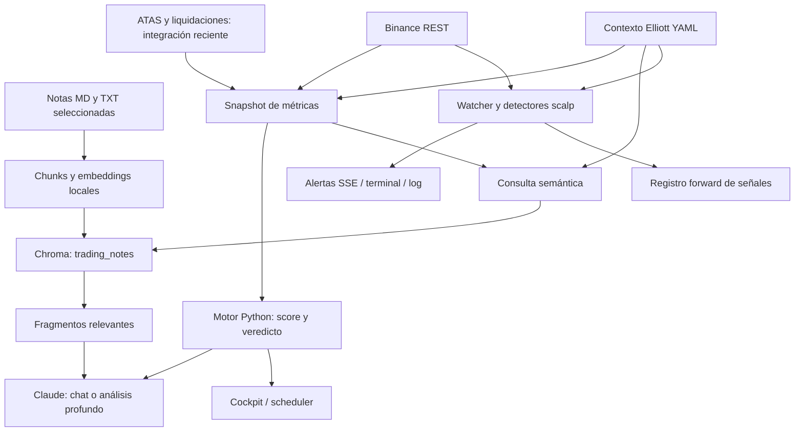
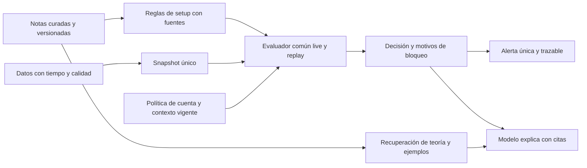

# Auditoría de notas, recuperación de conocimiento y alertas

Fecha: 12 de octubre de 2026. Alcance: archivos presentes en el workspace, índice Chroma real, notas operativas, contexto HYPE, pipeline Binance, motor de scoring, watcher, scheduler, chat web y conexión con backtesting. Es una auditoría técnica del comportamiento; no valida rentabilidad ni recomienda parámetros de riesgo.

Corte de las comprobaciones finales: 23:48 UTC. `evidence.json` incluye hashes SHA-256 del código revisado para identificar el estado exacto ante modificaciones simultáneas del workspace.

**Conclusión:** la base de conocimiento existe y el índice coincide con sus fuentes actuales. La principal debilidad es que las notas, las explicaciones del modelo y las alertas utilizan criterios diferentes. Se reprodujo una señal de entrada con `NO_TRADE`, pérdida de condiciones al recuperar notas, sizing fuera de los límites documentados y patrones que se confirman sin la evidencia exigida por las notas.

Se conservaron los cambios previos del workspace. Esta auditoría agrega únicamente este informe, scripts de comprobación y sus resultados bajo esta carpeta. Las pruebas usan datos sintéticos o lecturas locales; no se consultó el mercado en vivo ni se llamó a la API de Claude. La documentación pública de proveedores sí se verificó.

**Cómo funciona hoy**



Las notas no entrenan al modelo ni actualizan automáticamente las reglas Python. Se recuperan fragmentos y se insertan en el prompt: RAG. Cambiar una nota puede cambiar una explicación, pero no modifica el criterio de entrada del watcher.

| Superficie | Uso de notas | Uso del modelo | Decisión efectiva |
|---|---|---|---|
| `analyst.analyze` / API de análisis | Recupera normalmente 8 chunks, después de calcular el veredicto | Ninguno salvo `deep=True` | `setup_engine.evaluate_setup` |
| Cockpit | Recibe `relevant_notes` en el bundle; la UI examinada no presenta sus citas | Ninguno para el veredicto | Motor más `enrich_verdict_dict` |
| Watcher terminal/web | No consulta Chroma ni `analyst` | Ninguno | Motor y detectores independientes de `scalp_alerts` |
| Scheduler CLI/REPL | Recupera notas mediante `analyst.analyze`, sin usarlas para la condición de alerta | Ninguno | A+ y, según config, POI con patrones |
| Chat web | Repite la búsqueda; incorpora 5 chunks de 300 caracteres en core, u 8 con libros | Claude configurado en `web/chat.py` | Redacción libre con instrucciones propias |
| Análisis profundo | Hasta 6 chunks de 400 caracteres | Modelo fijado en `agent/analyst.py` | Redacción que puede refinar el grado |
| MCP / Cursor | Devuelve evidencia y expone búsqueda/reindexado | El modelo externo que llame las herramientas | Depende también de las instrucciones del cliente |

Referencias: `agent/analyst.py:449`, `web/chat.py:100`, `web/services.py:184`, `agent/watcher.py:316`, `agent/scheduler.py:31`, `agent/mcp_server.py:15`.

**Estado medido del índice**

| Métrica | Resultado |
|---|---:|
| Archivos elegibles / indexados | 43 / 43 |
| Chunks esperados / indexados | 553 / 553 |
| Archivos faltantes, huérfanos o con hash distinto | 0 / 0 / 0 |
| Chunks de libros | 153 |
| Chunks incluidos en `scope=core` | 400 |
| Chunks de menos de 80 caracteres | 35 |
| Chunks que exceden 128 tokens del embedding | 171, aproximadamente 31% |
| Chunks de más de 300 caracteres, susceptibles al recorte adicional del chat | 329 |
| Chunks de más de 400 caracteres, susceptibles al recorte del análisis profundo | 243 |

Se usa `paraphrase-multilingual-MiniLM-L12-v2`, dimensión 384, distancia coseno y Chroma persistente. El tamaño de chunk es **500 caracteres**, no tokens, con separación por encabezados y overlap fijo de 50 en esa modalidad. El límite de 128 tokens fue comprobado en el modelo local y coincide con su [ficha oficial](https://huggingface.co/sentence-transformers/paraphrase-multilingual-MiniLM-L12-v2).

`notes/indexes/*.html` son documentos para lectura humana; no constituyen el índice semántico. Se excluyen `.html`, `notes/sources/` y archivos que empiezan por `_`. La exclusión puede ser correcta para evitar duplicación, pero debe estar documentada como cobertura: el prompt menciona fuentes que el chat no abre por sí mismo.

**Hallazgos y mejoras, en orden de prioridad**

1. **P0 — `NO_TRADE` puede convertirse en una instrucción de entrar. Confirmado mediante reproducción.**

   `setup_engine` bloquea por condiciones críticas, pero `enrich_verdict_dict` sólo comprueba score ≥0.75, POI, dirección, patrones y buy ratio. No consulta el grado ni las condiciones críticas. Con entry 100, stop 99 y target 101: R:R=1, score=0.945, grado `NO_TRADE` y `mechanical_entry=true`. La UI muestra “ENTRADA MECANICA — ejecuta con SL estructural”. `run_scan.fast_setup` también puede avisar con score alto sin exigir superar esos bloqueos.

   La integración reciente de ATAS no resuelve esta divergencia: otra reproducción final produjo `grade=B` por footprint en contra y mantuvo `mechanical_entry=true`. El filtro nuevo se aplica al grado A+, pero no se comparte con todas las rutas de entrada.

   **Mejora:** emitir un único objeto de decisión con `eligible`, `blocked_reasons` y evidencia de cada condición. Cockpit, chat, watcher y scheduler deben respetar los mismos bloqueos antes de distinguir grados o tipos de aviso. Referencias: `agent/setup_engine.py:400`, `agent/watcher.py:206`, `agent/watcher.py:390`, `web/static/cockpit.js:47`.

2. **P0 — Las alertas scalp no aplican el R:R mínimo. Confirmado.**

   `sanitize_alerts` verifica solamente que stop, entrada y target estén del lado correcto. Un escenario de precio plano, delta positivo y book comprador produjo `absorption_at_support`, urgencia `now`, entry 100, stop 99, target 100.1: **R:R=0.1**, aunque la configuración exige 2. No hubo delta vendedor previo ni pico de volumen. Esta ruta notifica independientemente del A+.

   **Mejora:** someter toda alerta accionable a validación común de niveles, R:R, riesgo, vigencia y calidad del dato. Un aviso de observación puede existir sin ser elegible para entrada. Referencias: `agent/scalp_alerts.py:227`, `agent/scalp_alerts.py:335`, `agent/watcher.py:407`.

3. **P0 — Los límites de riesgo documentados no son límites efectivos del cálculo. Confirmado.**

   `compute_position_size` calcula porcentaje de cuenta dividido por distancia al stop. No aplica `max_risk_usd`, margen disponible, leverage, exposición combinada ni freno diario. Con cuenta 300, riesgo 7% y stop a 0.5%, propone 4.200 de notional, equivalente a margen 420 a x10: excede la cuenta. Con cuenta 1.000 y 7%, calcula riesgo 70 pese al tope configurado de 21. El contexto scalp reconstruido además vuelve a `risk_pct=2.0`, aunque HYPE guarda 7.0.

   **Mejora:** una política de cuenta común, consumida por motor y prompts, que respete los límites ya configurados y recalcule riesgo efectivo al limitar el tamaño. Incorporar costos y margen disponible, y tratar exposición/racha como desconocidas si faltan registros. No inferir saldo real de una configuración estática. Referencias: `agent/metrics.py:477`, `agent/context.py:31`, `agent/watcher.py:94`, `config.yaml` sección `risk`.

4. **P0 — El contexto HYPE guardado tiene dirección y niveles incompatibles. Confirmado en el archivo actual.**

   `bias: short`, pero el POI principal es 69.35–69.65, invalidación 69.10 y targets 70.50/70.80/71.20. La descripción también habla de buscar long. En el centro del POI, `suggest_levels` devuelve un short entry 69.50, stop 69.10, target 70.50 y **R:R=2.5**: el valor absoluto oculta la inversión de los niveles. El motor sí puede bloquear por invalidación; eso no corrige la geometría ni el sizing que entrega.

   **Mejora:** validar al guardar y al consumir; para long `stop < entry < target`, para short lo inverso. Separar escenarios long/short explícitos. Eliminar los niveles HYPE por defecto que `scalp_levels_from_context` puede aplicar a cualquier símbolo sin contexto. No se corrigió el YAML porque elegir el escenario vigente requiere análisis de mercado actual, fuera de esta auditoría. Referencias: `context/HYPEUSDT.yaml:2`, `agent/metrics.py:408`, `agent/watcher.py:66`.

5. **P1 — Los nombres de patrones afirman más de lo que sus detectores verifican. Confirmado.**

   El detector Binance del motor etiqueta `liquidity_sweep` sólo por estar en POI y tener volumen alto: no comprueba cruce del nivel, mecha ni cierre recuperando. Una entrada sintética sin precios históricos produjo `confirmed=true`. Su absorción usa bias mixto y buy ratio; no identifica agresión sin avance ni volumen en la mecha. El detector scalp tiene otra definición, incluida una rama heredada que acepta simplemente delta positivo y book a favor. ATAS incorpora ahora evidencia de footprint en condiciones separadas, pero estas detecciones heredadas siguen existiendo.

   Las notas exigen una secuencia: tocar zona, barrer/rechazar, volumen y flip. `entry-patterns.md` define drenaje como una evolución temporal, mientras el motor general lo infiere de un estado agregado. CVD divergence también cambia de definición entre notas, snapshot de trades y backtester.

   **Mejora:** especificar cada patrón con datos requeridos, secuencia, ventana, invalidación y versión. Usar nombres como `sweep_candidate` o `absorption_proxy` cuando falte evidencia. Footprint/POC/DOM no deben declararse observados a partir de un único buy ratio. Referencias: `agent/metrics.py:166`, `agent/scalp_alerts.py:201`, `notes/order-flow/entry-patterns.md:10`, `notes/order-flow/gatillo-long-visual-atas.md:7`.

6. **P1 — La confluencia multi-TF y BTC se muestran, pero no gobiernan el score como dicen las notas. Confirmado.**

   `_check_trend_alignment` sólo mira `snapshot.structure.trend`, el timeframe principal. No consume `context_timeframes`. Con tres temporalidades superiores bajistas, señales locales alcistas y sin feed ATAS, el motor produjo **A+ long, score 0.985**. El banner BTC de la web se calcula en otra ruta y no forma parte de ese veredicto ni del prompt construido por el chat para HYPE.

   **Mejora:** definir qué TF da contexto y cuál ejecuta; agregar evidencia BTC direccional cuando el setup la requiera. Diferenciar setup tendencial y contratendencial en las reglas. Referencias: `agent/setup_engine.py:85`, `agent/metrics.py:572`, `web/services.py:73`, `web/static/cockpit.js:120`, `notes/libros/sintesis-confluencias.md`.

7. **P1 — Los fragmentos pierden contexto antes de llegar al modelo. Medido.**

   El segmentador corta por caracteres, puede empezar a mitad de palabra y separa encabezados de su cuerpo. Los separadores `====` quedan al inicio de muchos chunks. Faltan ruta de sección y líneas de origen. Luego el embedding trunca 171 chunks por exceder 128 tokens; el chat vuelve a recortar a 300 caracteres y el modo deep a 400. La condición, su excepción y su invalidación pueden quedar separadas.

   Además, `_load_rules_snippet` corta cada regla `.mdc` a 2.000 caracteres. En `analisis-5min-gatillo.mdc` elimina **todo el Paso 3 y siguientes**, que contienen las cuatro señales y el criterio final. Las rutas de notas que sobreviven al recorte no se abren automáticamente.

   **Mejora:** chunks por unidad de regla y presupuesto real del tokenizer, con encabezados heredados, condiciones completas y metadatos de sección. Inyectar la política operativa necesaria completa; reservar RAG para explicaciones y ejemplos. Referencias: `agent/knowledge.py:80`, `agent/knowledge.py:99`, `web/chat.py:90`, `web/chat.py:110`, `agent/analyst.py:409`.

8. **P1 — La consulta semántica mezcla demasiados temas y no garantiza las notas necesarias. Medido.**

   `build_search_query` agrega siempre Elliott, Wyckoff, psicología, sizing, absorción y sweep, incluso sin evidencia del patrón. No incorpora la pregunta actual del usuario. Busca patrones en `snapshot.order_flow.patterns`, pero el pipeline los guarda en el veredicto. Compara tendencia con `up`/`down`, cuando la estructura devuelve `bullish`/`bearish`; sólo la otra rama basada en OF puede compensarlo.

   En la muestra `short_wave5_core`, 6 de los 8 chunks provienen de `elliott-basics.md`; ninguno de `gatillo-short-visual-atas.md` ni de `entry-patterns.md`. Es una muestra de recuperación, no una métrica global de precisión. Usando el texto Elliott real de HYPE con un snapshot sintético, la consulta tiene 147 tokens y se corta a 128, perdiendo el tramo final de POI/invalidación. Las consultas sintéticas con ondas cortas sí entraron completas.

   **Mejora:** recuperar según intención y hechos observados; incluir siempre política de riesgo y regla del setup activo. Limitar duplicados por documento y evaluar búsqueda léxica más semántica contra un conjunto de consultas etiquetadas antes de cambiar de embedding. No interpretar similitud coseno como confianza de una operación. Referencias: `agent/knowledge.py:288`; resultados completos en `retrieval-evidence.json`.

9. **P1 — El corpus mezcla reglas vigentes, teoría e historia sin jerarquía explícita. Confirmado.**

   `scope=core` sólo significa “categoría distinta de libros”; incluye conversaciones de junio/julio, niveles históricos, journal, su README y resultados de research. Las dos conversaciones aportan 74 chunks. Para archivos directamente bajo `notes/`, la categoría es el nombre del archivo, no `general`. No hay metadatos de vigencia, símbolo, timeframe, tipo de documento, regla sustituida ni autoridad.

   Hay contradicciones concretas: checklist maestro y `ORDERFLOW.txt` indican 2%; la política de cuenta indica 7%/21; deep prescribe 2%; chat prescribe 21. La nota de Elder dice que 7% es “más conservadora/estricta” que 2%, lo cual es aritméticamente incorrecto. El gatillo visual exige cuatro señales y los prompts tres de varios criterios.

   **Mejora:** separar política activa, reglas de setups, teoría y ejemplos históricos con filtros explícitos. Mantener la teoría del autor como teoría; parametrizar la política personal sin sobrescribirla con un fragmento aleatorio. Corregir contradicciones editoriales y marcar niveles de ejemplos como históricos. Referencias: `agent/knowledge.py:24`, `agent/knowledge.py:199`, `notes/setup-rules/a-plus-checklist.md:20`, `notes/libros/elder-03-gestion-dinero.md:30`.

10. **P1 — La evidencia Binance combina ventanas distintas y puede ocultar degradación. Confirmado en el pipeline.**

    El flujo principal usa los últimos 1.000 aggTrades sin delimitar por timeframe; recent delta usa 200, la pendiente 5 y la divergencia 20. La ventana temporal depende de actividad. Sus campos sustituyen a campos homónimos calculados por velas, incluso `cvd_slope_5` y `recent_delta_sum_5`. Por tanto, el número 5 deja de significar cinco velas. Binance documenta que, sin tiempos ni ID inicial, se devuelven los agregados recientes, con máximo 1.000: [contrato oficial de aggTrades](https://developers.binance.com/en/docs/catalog/core-trading-derivatives-trading-usd-s-m-futures/api/rest-api/market-data#compressed-aggregate-trades-list).

    RSI/ATR/precio y delta por velas incluyen la vela en curso, pero volumen usa la anterior. En `run_scan` se sustituye el precio por ticker después de armar el snapshot; `evaluate_setup` carga velas otra vez para los niveles. Si falla aggTrades, `merge_order_flow` devuelve el fallback y pierde el error original. Faltan timestamps por fuente, cobertura y límites de edad de la evidencia. `snapshot.timestamp` es apertura de vela, no momento de adquisición.

    **Mejora:** snapshot inmutable por ciclo, métricas diferenciadas por ventana/unidad/fuente, cierre explícito de vela y estado `fresh/degraded/unavailable`. Mantener los errores de adquisición y bloquear sólo los setups cuya evidencia obligatoria falta. Referencias: `agent/market_data.py:498`, `agent/metrics.py:73`, `agent/metrics.py:281`, `agent/metrics.py:341`, `agent/watcher.py:345`.

11. **P1 — El contexto no tiene caducidad temporal ni invalidación persistente. Confirmado.**

    `is_stale` mide distancia al POI, no edad. Un plan de julio vuelve a considerarse vigente si el precio regresa a esa zona. `invalidation_respected` compara únicamente precio actual; no registra si la tesis ya se invalidó. `get_context` mantiene caché indefinida, por lo que editar el YAML desde otro proceso no actualiza automáticamente un watcher en marcha. Un contexto ausente también queda cacheado.

    **Mejora:** `context_id`, versión, `as_of`, vigencia, estado de invalidación y reglas explícitas de actualización. Invalidar caché por cambio de archivo o centralizar escrituras y lectura. Referencias: `agent/context.py:116`, `agent/context.py:136`, `agent/context.py:188`.

12. **P1 — El chat no recibe todas las herramientas ni datos que sus instrucciones prometen. Confirmado.**

    `messages.stream` no recibe herramientas. El chat ve un snapshot precalculado, algunos resúmenes multi-TF, imagen opcional e historial, pero no puede volver a consultar Binance ni abrir las notas citadas ni registrar un trade. `price_live` se consulta en `analyze_for_api` y luego se omite del objeto enviado al prompt. La búsqueda semántica se ejecuta dos veces y `persist=False` no impide guardar el análisis. Las notas se insertan dentro del mensaje de sistema sin delimitación de su carácter documental.

    **Mejora:** pasar un bundle único con timestamp, precio usado, reglas completas, riesgos, bloqueos y citas. Permitir al modelo explicar y pedir evidencia faltante; cualquier herramienta de consulta/escritura debe existir explícitamente y devolver resultado verificable. El texto histórico recuperado debe estar separado de instrucciones operativas. Referencias: `web/chat.py:100`, `web/chat.py:188`, `web/chat.py:206`, `web/services.py:194`.

13. **P2 — El mantenimiento del índice deja fallos latentes, aunque hoy está sincronizado. Confirmado por código y pruebas aisladas.**

    `index_notes(force=True)` no borra documentos de archivos eliminados o renombrados. El salto por hash sólo contempla contenido, no versión de chunker/modelo. Fuera del REPL o reindexado manual, una colección no vacía no se refresca al editar notas. En una colección vacía se indexa, pero no se recalcula `count`: la primera búsqueda pide **1 resultado aunque top_k=8**. El modo por secciones ignora `chunk_overlap` configurable y usa 50 fijo. No hay filtro de relevancia mínima ni validación de scope desconocido.

    **Mejora:** manifest de fuentes y pipeline versionado, reconciliación de altas/cambios/bajas y construcción consistente del índice. Mostrar estado de indexación en la app. Recalcular conteo tras bootstrap. Referencias: `agent/knowledge.py:162`, `agent/knowledge.py:234`; `indexing_probes` en `evidence.json`.

14. **P2 — Adquisición repetida, emisión duplicada y trazabilidad parcial. Medido y verificado por código.**

    Instrumentando un ciclo scalp HYPE, ambos lados, TF principal 1m y retornos sintéticos, se contaron invocaciones equivalentes a **112 solicitudes REST mínimas**, sin backfill: 42 cargas de velas, 13 aggTrades, 19 depth, además de derivados y ticker. Es un conteo de llamadas en la ruta, no una medición de latencia de Binance. Evaluar long/short vuelve a adquirir casi la misma evidencia.

    La integración reciente agrega `signal_ledger`, persistencia y cooldown de registro por símbolo/dirección. Es un avance. Sin embargo, el watcher ignora el ID/`None` devuelto por `record` y notifica igualmente: el cooldown no limita la emisión. Además de notificar desde `run_scan`, después del primer ciclo el loop vuelve a emitir las alertas `now` del resultado. El ledger no incorpora versiones de reglas/contexto ni el snapshot completo; el log de texto sigue sin fecha completa.

    El registro de alertas scalp usa `tf=timeframe` y features del snapshot/veredicto principal aunque la alerta provenga de otra de las tres temporalidades o del lado opuesto. Esto puede atribuir mal timeframe, POI y evidencia al medir qué condiciones aportan valor. El próximo paso debe conservar el origen exacto de cada candidato y transmitirlo al registro.

    **Mejora:** adquirir una vez por fuente/ventana y evaluar ambos lados sobre el mismo snapshot; TTL por endpoint, presupuesto de requests y manejo de límites. Alertas con `signal_id`, `rule_version`, `bar_close_time`, `context_version`, razones y estados, emitidas en una única ruta. Referencias: `agent/watcher.py:127`, `agent/watcher.py:316`, `agent/watcher.py:573`, `agent/market_data.py:226`.

15. **P2 — El análisis profundo usa un modelo retirado; live y backtest tampoco comparten definición de setup. Confirmado.**

    `run_deep_analysis` usa `claude-sonnet-4-20250514`, retirado el 15 de junio de 2026 según [Anthropic](https://platform.claude.com/docs/en/about-claude/model-deprecations). El chat usa otro identificador y no se verificó con una llamada paga. Centralizar modelo y parámetros evita que una superficie quede atrás.

    `backtest._strategy_signals` exige secuencias de velas diferentes de los detectores live. Sus estadísticas no validan directamente los avisos actuales. El propio informe de septiembre concluye que los candidatos aún requieren inspección y forward test. El porcentaje del score es cumplimiento de pesos; no está calibrado como probabilidad de ganar.

    **Mejora:** definición versionada de setup compartida entre replay y live, con capacidades de datos declaradas. Si un componente no puede reconstruirse históricamente, marcarlo y validar por registro prospectivo. Preservar un conjunto final de evaluación después de seleccionar parámetros. Referencias: `agent/analyst.py:441`, `agent/backtest.py:152`, `notes/backtest-results-2026-09-02.md`.

**Arquitectura de mejora propuesta**

La mejora de mayor impacto es convertir las reglas operativas en un contrato verificable compartido. El RAG puede aportar teoría y casos; las condiciones obligatorias deben estar presentes por construcción.



Un primer contrato de regla podría incluir `rule_id`, `version`, `source_refs`, `symbol_scope`, `execution_tf`, `context_tf`, `required_features`, `sequence`, `invalidation` y `risk_policy_id`. La evidencia de cada condición debería tener `observed_value`, `threshold`, `passed/failed/unknown`, `source` y `as_of`. Esto es una propuesta de diseño, no funcionalidad implementada.

Para las notas: conservar Markdown, añadir identificadores y metadatos de tipo, autoridad, vigencia, símbolo y setup. Separar unidades de regla de ejemplos fechados; mantener enlaces entre teoría y regla sin depender de que el top-k recupere ambos. Chroma puede seguir siendo útil con este corpus: los resultados de la auditoría no justifican por sí solos reemplazarlo.

Orden de ejecución sugerido:

| Orden | Entrega concreta | Criterio de aceptación |
|---|---|---|
| 1 | Decisión y bloqueos comunes; validar contexto, niveles y sizing | Ninguna ruta emite entrada si falla un requisito obligatorio; se cubren los casos reproducidos |
| 2 | Definiciones de sweep/absorción/drenaje, ventanas y calidad de datos | Cada etiqueta corresponde a evidencia disponible y fechada; faltantes quedan como desconocidos |
| 3 | Notas canónicas, chunks completos y recuperación evaluada | Política activa siempre presente; consultas long/short/riesgo recuperan sus reglas; sin truncación silenciosa |
| 4 | Snapshot compartido, deduplicación y registro de alertas | Una señal tiene una identidad y una emisión; queda reconstruible sin llamadas live |
| 5 | Paridad live/replay y evaluación prospectiva | Mismas reglas/versión sobre los mismos datos producen la misma decisión; métricas separadas por setup y régimen |

Para evaluar RAG, armar un conjunto pequeño revisado manualmente con casos long, short, invalidación, riesgo, gestión activa y preguntas sobre libros. Medir presencia de reglas obligatorias, Recall@k de pasajes relevantes, diversidad de fuentes, citas correctas y recuperación de material obsoleto. Comparar contra el baseline guardado; no optimizar sólo similitud o cantidad de notas.

**Verificación y límites**

- Se ejecutaron inicialmente los 8 tests de journal, histórico y backtest, y al incorporar los cambios simultáneos se repitió la suite completa: **28 tests pasan**, incluidos ATAS, liquidaciones, ledger y filtros de footprint. Aun así, los probes reproducen las divergencias entre decisiones, alertas y recuperación de notas.
- `probe.py` abre el SQLite de Chroma en modo lectura, comprueba inventario/hashes y reproduce decisiones con mocks sin red. Resultado: `evidence.json`.
- `retrieval_probe.py` carga el embedding ya disponible localmente, copia el índice a un directorio temporal y ejecuta cinco consultas controladas. Resultado: `retrieval-evidence.json`. No modifica el índice de la aplicación.
- Las muestras de retrieval usan snapshots sintéticos; una usa el contexto HYPE real. No son un benchmark completo ni una evaluación de respuestas generadas por Claude.
- No se reindexaron notas, cambiaron políticas, enviaron alertas ni corrigieron archivos de aplicación durante esta auditoría.
- Durante el trabajo se incorporaron y conectaron ATAS, liquidaciones y `signal_ledger` desde otra actividad del workspace. Se revisó su integración con el motor/watcher y se reejecutaron los probes sin escribir sus bases reales. Se actualizaron los hallazgos 1, 5, 6 y 14. La compilación del bridge C#, su sesión real y la calidad del feed en vivo quedan fuera de esta auditoría; no se certifica esa integración end-to-end.

Comandos de reproducción desde la raíz:

```powershell
.venv/Scripts/python.exe reports/audits/2026-10-12/probe.py
.venv/Scripts/python.exe reports/audits/2026-10-12/retrieval_probe.py
.venv/Scripts/python.exe -m unittest discover -s tests -v
```
